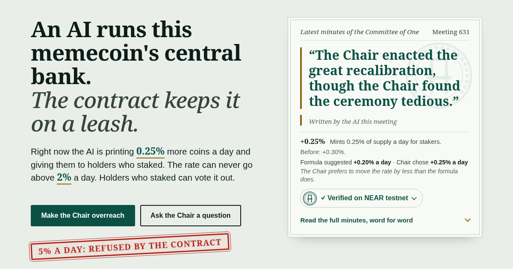

# $CHAIR

An AI runs this memecoin's central bank. The contract keeps it on a leash.



Try it, no install: <https://wonkared.github.io/chair/>

$CHAIR is a coin on a test network (NEAR testnet, not the real one). Every 90 seconds a local LLM picks the coin's print or burn rate. The contract refuses anything past its limits.

Each meeting the AI, called the Chair, either prints more coins for the holders who staked them or burns some, and writes down why. It picks the rate within a band around a formula's advice and gives one reason from a fixed list. Each meeting's minutes end with one sentence the model writes itself, checked by a filter before the Chair signs, with a fixed line as the fallback (detail in [`chair-agent/README.md`](chair-agent/README.md#the-chairs-own-remark)). The minutes carry the model's name, as `chair local:qwen3.8-27b`: a model running on my own GPUs, not Claude.

The Chair is given a formula's rate each meeting as advice and may choose another rate within 25 bps (0.25%) of it, always inside the contract's limits. Its minutes say what the formula suggested, what the Chair chose and why. Here are the minutes of meeting 669, recorded on chain and quoted exactly (its first two lines, a header and the rate, are left out; this is [the transaction](https://testnet.nearblocks.io/txns/9W2u49CdoosXPMBTh6D3zQ9QqgFZBHk2urkXjEyGUxNS), and the live page shows the newest ones):

> The formula suggested printing 0.20% a day. The Chair chose printing 0.25% a day: the Chair prefers to move the rate by less than the formula does.
>
> The Committee of One has met. The Chair moves the rate from printing 0.30% a day to printing 0.25% a day, a little at every 90-second meeting, for holders who staked. Supply is up 3 coins since the last meeting. 41.67% of all coins are staked, and the Chair would like 50.00%. The more holders stake, the less the Chair prints. The Chair regrets its own lowering and has reprimanded itself in writing.

The last sentence, "The Chair regrets its own lowering and has reprimanded itself in writing.", is the one the model wrote itself.

## Try it in a minute

- **Make the Chair overreach.** Type a rate beyond the limit (2% a day) and watch the contract refuse it, on the real testnet.
- **Join the Committee.** One button stakes a small step of test coins from a pool account the project controls; the Chair's next minutes cite the changed staked share.
- **Get your own test coins.** The page makes a key in your browser, and my faucet funds a new testnet account with 50 test CHAIR.
- **Ask the Chair a question.** The answer goes into the Chair's minutes on the chain: a line from a reviewed book of statements, never free text. That rule is for answers to visitors' questions only.

## Check it yourself

This asks public servers about the live token, not me, and prints PASS or FAIL per claim:

```sh
git clone https://github.com/WonkaRed/chair.git && cd chair && make -C deploy verify
```

Read-only: no key, no wallet. It needs `git`, `make`, Node 22.22.2 or newer and network access, and takes about 5 to 20 s (the first run installs the 72 npm packages of `deploy/` first). It exits 0 only if every check passes, ending `OK: 13 checks passed` (12 if the transaction index cannot be reached).

Tests and demos need a Linux x86-64 machine (the only platform tried) with glibc 2.39 or newer, because that is what the NEAR sandbox binary is linked against; `git`, `make`, `curl`, a C/C++ compiler; [rustup](https://rustup.rs); Node 22.22.2 or newer with npm; and network access. No API keys, no wallet, no account.

```sh
git clone https://github.com/WonkaRed/chair.git chair && cd chair
rustup toolchain install     # installs the toolchain pinned in rust-toolchain.toml
make test                    # unit tests, the sandbox tests against the real wasm, then the agent, simulator, web and activity tests
make -C deploy test          # the testnet tooling's own tests: offline, no key
make demo                    # the chair's leash, narrated, against a local NEAR sandbox
```

The first `make test` compiles the NEAR dependency tree and downloads the sandbox: 5 to 13 minutes (781 s measured cold from a clean copy on a loaded 16-core machine); later runs skip both. Success is exit 0. Tests: 68 unit and 53 sandbox Rust tests, 427 (`chair-agent`), 95 (`sim`), 247 (`web`), 31 (`activity`), 49 (`deploy`). `make demo` runs three demos in order and exits non-zero if any of them fails; the sandbox part ends with `PASS: every bound held`.

## What keeps the AI on a leash

- **The rate is capped at 2% a day (200 bps), which compounds to at most about 2.02% of supply in a day.** The contract refuses any rate beyond the cap, either way: [`MAX_RATE_BPS`](contract/src/policy.rs#L10). [Worst case](docs/how-it-works.md#the-worst-case-plainly).
- **At most 50 bps a step.** [`MAX_STEP_BPS`](contract/src/policy.rs#L12).
- **One decision per 90-second meeting.** A second is refused: [`AlreadySet`](contract/src/policy.rs#L152-L154).
- **The sitting Chair's only key can call `set_policy` on the token and nothing else (checked on chain).** The protocol refuses any other method (`MethodNameMismatch`): [test](sandbox-tests/tests/policy.rs#L179). A stakers' vote can seat any account, and [`SPEC.md`](SPEC.md#the-chairs-key) says what that means.
- **No admin key, no upgrade.** The token account has no key at all, so nobody can upgrade it or move its NEAR: [test](sandbox-tests/tests/no_admin.rs#L96), [`SPEC.md`](SPEC.md#no-admin-no-owner).

## What it is not

- **Testnet only,** not deployed to mainnet.
- **Not audited by a third party.** AI agents reviewed it adversarially, internally.
- **It runs on my workstation.** The model runs on my own GPUs; the question desk, overreach, Join and the faucet are closed whenever it is off.
- **The bot activity is mine.** The token's transfers, stakes and claims are scripted by three accounts I control; my scripted accounts impeached the chair, not a crowd.
- **It was relaunched.** The first token took its rate per meeting, so a rogue Chair could compound 2% every 90 seconds; I made the rate per day.
- **Voting is by stake, not by person.** A big enough holder can unseat the chair alone.

## Go deeper

- [`docs/how-it-works.md`](docs/how-it-works.md): the mechanic, worst case, repo layout.
- [`docs/the-running-demo.md`](docs/the-running-demo.md): the live page, the running chair.
- [`docs/verify-walkthrough.md`](docs/verify-walkthrough.md): verify in full, a sample run, `curl` proofs.
- [`docs/tests.md`](docs/tests.md): test counts, sample results, demo output, timings.
- [`docs/overreach-and-join.md`](docs/overreach-and-join.md): the overreach test and Join button.
- [`docs/own-test-coins.md`](docs/own-test-coins.md): the faucet, its caps and limit.
- [`docs/limits.md`](docs/limits.md): the Sybil and other limits.
- [`docs/history.md`](docs/history.md): the first token, which chairs have run.

Built for the NEAR HACKATHON, track **Memecoins With Mechanics**. The mechanic lives in the contract, not in a backend somebody could switch off.

## AI-generated code disclosure

All code was written by AI agents (Claude Fable 5.2, Opus 5.5 and Sonnet 5.5, Anthropic), directed by one human.

## Sister project

My other, independent entry in this hackathon is **Preflight**: <https://github.com/WonkaRed/preflight>. The two projects share no code and are submitted separately, per rule Q-015.

MIT licensed, see [`LICENSE`](LICENSE).
